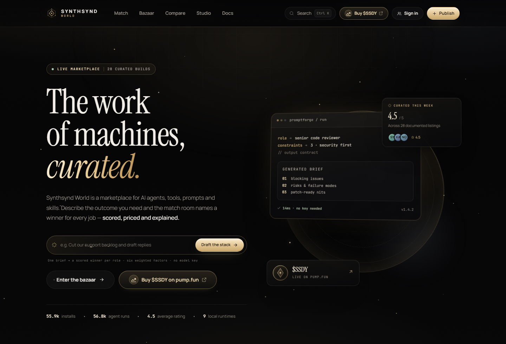
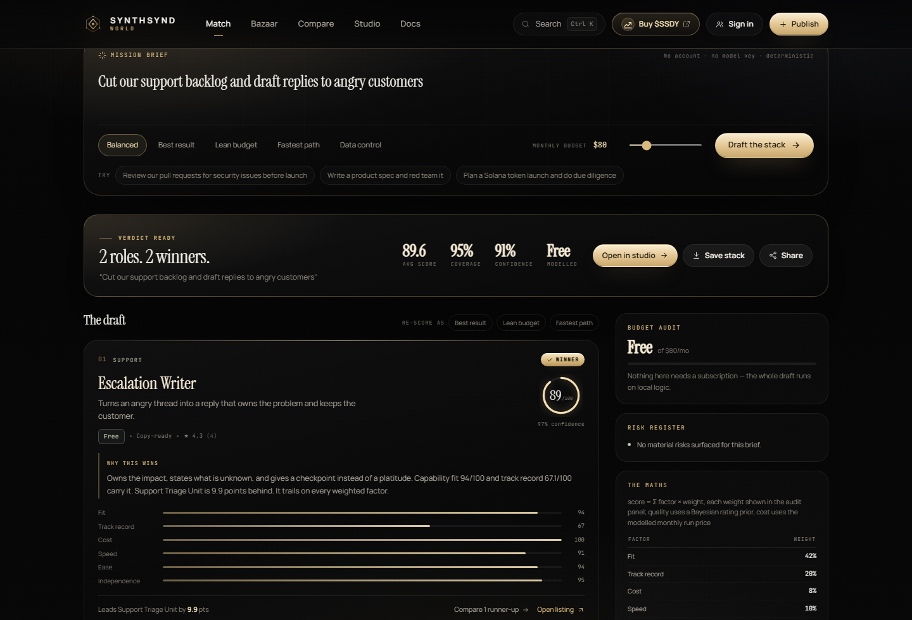
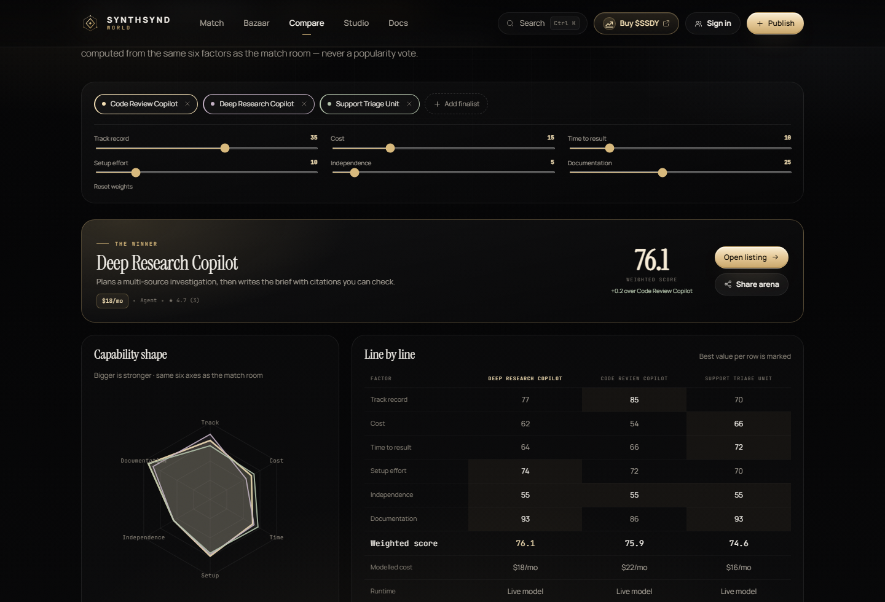
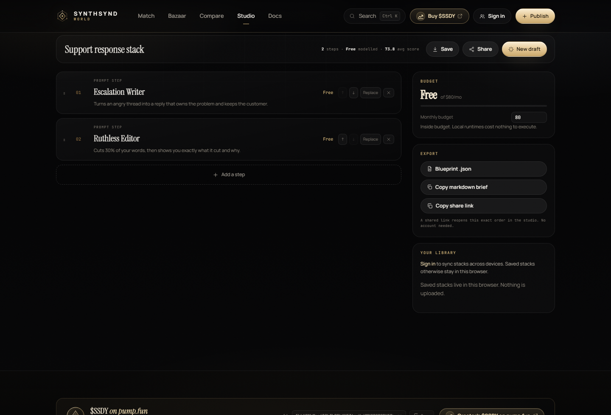

# Synthsynd World

**The agent bazaar with a decision layer.** A working marketplace for AI agents, tools, prompts and skills — plus a deterministic match engine that names a winner for every job, real accounts, real Postgres, and a stack studio that exports the plan. Built to deploy on Vercel with Supabase behind it.



| Match room — winners, margins, budget | Compare arena — weighted verdict |
| --- | --- |
|  |  |



---

## What it is

- **The bazaar** — 28 curated listings across agents, tools, prompts and skills, plus community publishing. Every listing ships its real prompt or logic, a version and an author.
- **The match room** — one brief becomes roles; every listing is scored on six factors with a printed weighting table; one winner per role with a runner-up margin, confidence, a budget audit with modelled swaps, a risk register and honest coverage gaps. Pure functions, instant, replayable, no model key.
- **The compare arena** — up to four finalists, six weight sliders, live verdict, radar chart and a line-by-line table. The URL carries the finalists and weights.
- **The studio** — the winning draft becomes a pipeline: reorder, replace, re-price, then save, sync, export a JSON blueprint or a Markdown brief. A shared link reopens the exact stack.
- **Real accounts** — Sign in with a magic link (or OAuth once providers are enabled). Stacks sync per account, reviews and published listings are attributed, and Postgres row-level security enforces everything.
- **Nine local runtimes** — Prompt Forge, Hook Lab, JSON → Schema, Prompt Cost Oracle, Markdown Grid, Regex Lab, Text X-Ray, Template Foundry, Degen Due Diligence. Real logic in the browser: instant, private, free.

Everything else about the product philosophy — show the work, run before install, publish in minutes, no empty promises.

## Architecture

```
┌────────────────────────── Vercel (static SPA) ───────────────────────────┐
│  React 18 + React Router + hand-written CSS                              │
│                                                                          │
│  Curated catalog ships in the bundle (src/lib/catalog.ts)               │
│  Match engine, profiles and deterministic runners run in the browser     │
│  (src/lib/match.ts, profiles.ts, runners.ts)                            │
│                                                                          │
│  supabase-js (anon key, PKCE auth) ─╮                                    │
└─────────────────────────────────────│────────────────────────────────────┘
                                      ▼
                    Supabase Postgres + Supabase Auth
                    published_items · reviews · events · metrics
                    matches · stacks (owner = auth.uid())
                    Row-level security everywhere; counters only via RPC
```

- There is no application server. The public anon key only reaches what RLS allows: public reads everywhere, authenticated writes to `published_items` and `reviews`, owner-only access to `stacks`, counter increments through the `bump_metric` SECURITY DEFINER function — never direct row edits.
- Curated listings live in the repo so the bazaar is reviewable and versioned. Community data lives in Postgres. The UI merges them; sorting, filtering, trending, match ranking and comparison all run client-side.

## Data model (Supabase)

| Table | Purpose |
| --- | --- |
| `published_items` | Community-published listings (insert = authenticated) |
| `reviews` | Rating + text per listing; averages computed live |
| `events` | Install / publish / review activity for the ticker |
| `metrics` | Per-listing installs / views / runs (seeded with history; bumped via RPC) |
| `matches` | Mission briefs scored by the match room (powers "recent drafts") |
| `stacks` | Saved stacks, keyed by `auth.users.id` with owner-only RLS |
| `auth.users` | Supabase Auth accounts (magic link, GitHub / Google OAuth) |

## Run it locally

Requires Node 18+.

```bash
npm install -D pg   # only needed for the seed script
npm install
cp .env.example .env   # fill VITE_SUPABASE_URL and VITE_SUPABASE_ANON_KEY
npm run dev            # http://127.0.0.1:8787
```

With no Supabase values the app still runs the full catalog, match room, compare arena, studio, all nine runners and the design system — sign-in, publishing, reviews and sync degrade honestly.

## Database setup (one time)

Apply the schema and seed once on a new Supabase project:

- **SQL editor**: paste the whole of [`supabase/setup.sql`](supabase/setup.sql) into Supabase → SQL editor and run it. Idempotent; safe to re-run.
- **CLI alternative**: `SUPABASE_DB_PASSWORD="..." node scripts/apply-schema.mjs` (reads only the public URL from `.env`; the password never touches files).

The setup creates the six tables, enables RLS with explicit policies, creates the `bump_metric` counter function, and seeds metrics, reviews and events from the same catalog module the app ships.

## Deploy to Vercel

[`vercel.json`](vercel.json) is included: Vite build, `client-dist` output, SPA rewrite to `/index.html`.

1. Import the GitHub repo in Vercel and deploy — no other settings required.
2. Add environment variables `VITE_SUPABASE_URL` and `VITE_SUPABASE_ANON_KEY` (Project Settings → Environment Variables).
3. In Supabase → Authentication → URL Configuration, add the Vercel domain to the allowed redirect URLs (or use a custom domain) so magic links return to the right origin.

Every future `git push` to `main` redeploys automatically.

## The match engine

The match room is a deterministic scoring function over the catalog, not a prompt wrapper:

1. **Split** the brief into jobs (a role needs at least two keyword signals; naming a listing pins it).
2. **Rank** every listing that plays that role on six factors: capability fit, track record (Bayesian rating prior + log-scaled usage), cost, speed, setup, independence.
3. **Weight** by the priority preset — balanced, best result, lean budget, fastest path, data control — and crown one winner per job with the runner-up margin recorded.
4. **Audit** the stack: modelled cost versus budget with cheaper swaps and their score cost, coverage, close calls, model-key dependencies, and production nouns the catalog cannot serve.

The same brief and settings always produce the same verdict, the weighting table is printed with every result, and score bars explain themselves. That's why a shared link shows exactly what you saw.

## Security notes

- RLS is the protection: public `SELECT` on catalog data, authenticated-only inserts for `published_items`/`reviews`, owner-only `stacks`, metrics mutated only via the granted RPC.
- Auth is PKCE magic link/OAuth through Supabase; sessions live in `localStorage` via the official client. Passwords never exist.
- The anon key is public by design — the database decides, not the key. The direct-connection postgres password is used once, locally, for seeding and is never committed.
- No third-party trackers, no cookies, reviews capped at 600 characters.

## Verification

- `npm run typecheck` — clean.
- `npm run build` — clean (a single vendor chunk over 500 kB is expected for an SPA without code splitting).
- `node scripts/smoke.mjs` — Playwright suite across routes, the match → studio flow, compare arena, runners, pump.fun links, command palette and 390px mobile with zero overflow.

## Roadmap

Semantic search over the catalog, stack runbooks (execute deterministic steps end-to-end), author profiles with public histories, listing claim/transfer, README revisions to the studio export.

## License

MIT — use it, fork it, extend it.
